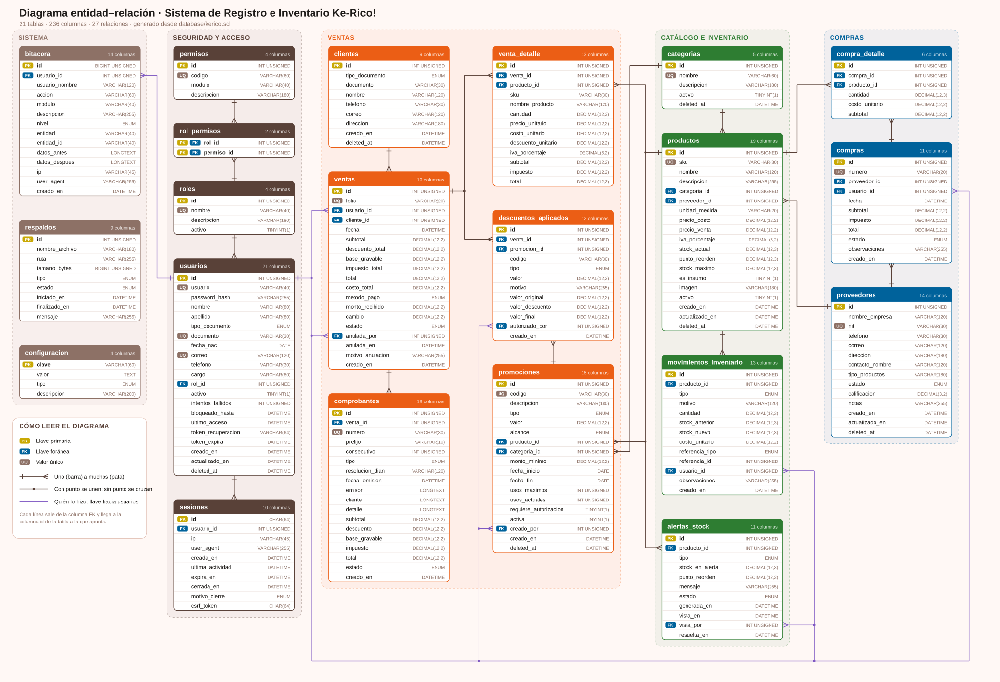

# Sistema de Registro e Inventario · Ke-Rico!

Sistema web para la gestión de ventas, inventario, comprobantes, proveedores y rentabilidad
del negocio de empanadas y fritos **Ke-Rico!** (Cra. 59 # 132A - 7, Suba, Bogotá D.C.).

Construido sobre el patrón **Modelo–Vista–Controlador**: una API REST en PHP 8 + MySQL/MariaDB
como modelo y controlador, y una aplicación React 19 como vista.

---

## Arranque rápido (XAMPP)

1. Instale [XAMPP](https://www.apachefriends.org/) e inicie **Apache** y **MySQL**.
2. Abra <http://localhost/phpmyadmin>, pestaña **Importar**, y cargue
   `database/kerico_seed.sql`. Crea la base `kerico`, las 21 tablas, la vista de inventario y los
   datos de arranque. Es lo único que hay que importar.
3. Copie la carpeta `publicar/` dentro de la carpeta `htdocs` de XAMPP. Puede llamarla
   como quiera; `kerico` es lo habitual. No hay nada que editar: la aplicación descubre
   su propia API en la subcarpeta `api/`.
4. Entre a <http://localhost/kerico/>.

Si algo no arranca, abra <http://localhost/kerico/api/diagnostico.php>: revisa la versión
de PHP, las extensiones, `mod_rewrite`, la conexión a MySQL, las 21 tablas, la vista de inventario y
el juego de caracteres, y dice exactamente qué falta. Por seguridad solo responde cuando se
abre desde el mismo equipo donde corre el servidor.

**Usuario:** `admin` · **Contraseña:** `123`

Los pasos detallados, el modo desarrollo y la solución de problemas están en
[INSTALACION.md](INSTALACION.md).

---

## Cuentas de prueba

Las cuatro cuentas existen para demostrar el control de acceso por rol. Todas usan la
contraseña `123` y su hash se guarda cifrado con bcrypt en la base de datos.

| Usuario | Rol | Qué puede hacer |
|---|---|---|
| `admin` | Administrador | Todo: reportes, precios, usuarios, respaldos, configuración |
| `gerente` | Gerente | Consultar ventas y comprobantes, promociones, proveedores y compras, puntos de reorden, bitácora |
| `cajero` | Cajero | Registrar ventas, emitir comprobantes, aplicar códigos de descuento |
| `inventario` | Inventario | Productos, ajustes de stock, compras, alertas |

---

## Estructura del repositorio

```
├── database/
│   ├── kerico_seed.sql         Esquema + vistas + datos de arranque (instalación normal)
│   └── kerico.sql              Esquema + vistas, sin datos (base en blanco)
├── backend/                    API REST en PHP 8 (modelo y controlador)
│   ├── index.php               Controlador frontal y tabla de rutas
│   ├── config/config.php       Conexión y parámetros (leídos de variables de entorno)
│   ├── nucleo/                 Autenticación, enrutador, validación, exportadores, PDF
│   ├── modelo/                 Lógica de negocio y acceso a datos
│   ├── controlador/            Un controlador por módulo
│   ├── diagnostico.php         Revisión del entorno: PHP, extensiones, base de datos
│   ├── tareas/respaldo.php     Respaldo automático programable
│   └── respaldos/              Destino de los archivos .sql generados
├── frontend/                   Aplicación React 19 + Vite 8 (vista)
│   ├── src/componentes/        Una pantalla por módulo
│   ├── src/ui/Componentes.jsx  Biblioteca de componentes de interfaz
│   ├── src/contexto/Sesion.jsx Sesión, permisos y cierre por inactividad
│   ├── src/ganchos/            Listados con paginación, filtros y orden
│   └── src/api.js              Cliente HTTP con token y CSRF
├── publicar/                   Carpeta lista para copiar a htdocs (frontend + api/)
├── herramientas/publicar.mjs   Regenera publicar/ desde frontend/dist y backend/
├── herramientas/diagrama-er.mjs  Regenera docs/diagrama-er.svg desde database/kerico.sql
├── docs/                       Requerimientos, matriz del proyecto y manual de identidad
└── diseno/                     Tablero de referencia y landing de la marca
```

---

## Modelo de datos



Las 21 tablas se agrupan en cinco módulos. El diagrama se genera desde el esquema con
`node herramientas/diagrama-er.mjs`, así que no se desactualiza: si el SQL gana una tabla o
una relación que el diagrama no ubica, el script se detiene y lo dice.

---

## Correo

Con un servidor SMTP configurado, todo lo que se descarga (comprobantes, reportes,
respaldos) también se puede enviar por correo con el botón **✉ Correo**; las alertas de
stock llegan al correo de avisos y «Olvidé mi contraseña» envía un código al usuario.
La configuración está en [INSTALACION.md](INSTALACION.md#7-envío-de-correo-smtp).

---

## Comprobantes en PDF

El PDF de un comprobante es igual al que muestra la página: mismas fuentes, medidas y
contenido. Para lograrlo lleva incrustadas las fuentes Work Sans y Baloo 2, que están en
`backend/recursos/fuentes/` junto a su licencia (SIL Open Font License 1.1).

La tirilla de la página (`Tirilla` en `frontend/src/componentes/GestionVentas.jsx`, con la
regla `.tirilla` de `index.css`) y la del PDF (`backend/nucleo/TirillaPdf.php`) se
mantienen a mano: un cambio en una debe repetirse en la otra.

---

## Requerimientos funcionales

| Código | Requerimiento | Dónde está |
|---|---|---|
| RF1 | Gestión de ventas y stock | `Ventas y stock` · descuenta existencias en la misma transacción |
| RF2 | Emisión de comprobantes digitales | `Comprobantes` · folio único, impuestos, almacenado y descargable |
| RF3 | Aplicación de descuentos y promociones | `Descuentos` · valida permiso, guarda motivo y valor antes/después |
| RF4 | Alertas automáticas de stock mínimo | `Alertas de stock` · punto de reorden configurable por producto |
| RF5 | Auditoría de movimientos de inventario | `Auditoría` · quién, qué, por qué, stock antes y después |
| RF6 | Gestión de proveedores | `Proveedores` · NIT, contacto, suministros y compras asociadas |
| RF7 | Análisis de rentabilidad | `Rentabilidad` · cruza costo de compra contra precio de venta |
| RF8 | Registro de actividad (logs) | `Registro de actividad` · bitácora completa con nivel e IP |
| RF9 | Inicio de sesión | Pantalla de acceso · bcrypt, bloqueo por intentos, recuperación con código por correo |

## Requerimientos no funcionales

| Código | Atributo | Cómo se cumple |
|---|---|---|
| RNF1 | Rendimiento | Venta y actualización de stock en una transacción, muy por debajo de 3 s |
| RNF2 | Rendimiento | Reportes mensuales con índices y vistas, por debajo de 10 s |
| RNF3 | Rendimiento | Sesiones independientes por token; varios usuarios en paralelo |
| RNF4 | Seguridad | Permisos por rol verificados en el servidor en cada ruta |
| RNF5 | Seguridad | Contraseñas con bcrypt; el hash nunca sale en las respuestas |
| RNF6 | Seguridad | Cierre automático de sesión a los 15 minutos de inactividad |
| RNF7 | Seguridad | Respaldo completo en `.sql`, manual o programado cada 24 horas |
| RNF8 | Fiabilidad | Estado del sistema consultable; errores registrados en bitácora |
| RNF9 | Fiabilidad | Restauración desde cualquier respaldo generado |
| RNF10 | Fiabilidad | Sin ventas negativas ni stock inexistente: validado en PHP y en la base |
| RNF11 | Usabilidad | Punto de venta de un solo toque por producto |
| RNF12 | Usabilidad | Diseño adaptable a móvil, tableta y escritorio |
| RNF13 | Usabilidad | Paleta y tipografía del Manual de Identidad Corporativa |
| RNF14 | Portabilidad | Exportación en PDF, Excel y CSV |
| RNF15 | Portabilidad | Métodos de pago configurables desde el catálogo de la venta |

---

## Seguridad

- **Contraseñas:** bcrypt con coste 10 o superior; rehash automático al iniciar sesión.
- **Acceso por rol:** cada ruta declara el permiso que exige; el intento denegado queda
  en la bitácora con el usuario y la IP.
- **Sesiones:** token aleatorio de 256 bits, caducidad por inactividad, cierre inmediato
  al desactivar o eliminar la cuenta.
- **Inyección SQL:** todas las consultas usan sentencias preparadas; las columnas de
  ordenamiento se validan contra una lista blanca.
- **XSS:** la entrada se sanea en el servidor y React escapa toda la salida.
- **CSRF:** cada sesión recibe un token propio que el cliente envía en la cabecera
  `X-CSRF-Kerico`; toda petición `POST`, `PUT` o `DELETE` sin token válido se rechaza.
- **CSV:** las celdas que empiezan por `=`, `+`, `-` o `@` se neutralizan para evitar
  ejecución de fórmulas al abrir el archivo.

---

## Borrado lógico

Productos, proveedores, usuarios, clientes, categorías y promociones nunca se borran de
la base de datos: se marca la columna `deleted_at` y el registro desaparece de los
listados. Cada módulo tiene su **Papelera** para restaurarlos, y el historial de ventas,
compras y movimientos permanece intacto.

---

## Impuestos

Los precios del catálogo son **precios finales al público**: ya incluyen el impuesto.
El sistema separa la base gravable del impuesto en cada línea de venta y en cada
comprobante. Los alimentos preparados usan 8 % de impuesto al consumo y las bebidas
envasadas 19 % de IVA; el porcentaje se define en cada producto, desde `Inventario`.

---

## Créditos

Proyecto formativo SENA · Ficha 3411795

| Integrante | Módulos |
|---|---|
| Juan Steban Peña Cárdenas | RF1 Ventas y stock · RF2 Comprobantes |
| Andrés Rodríguez | RF3 Descuentos y promociones |
| Esteban Torres | RF4 Alertas de stock · RF5 Auditoría de movimientos |
| Juan Esteban Ávila | RF6 Proveedores · RF7 Rentabilidad |
| Cristian David Molano Pérez | RF8 Registro de actividad · RF9 Inicio de sesión |
